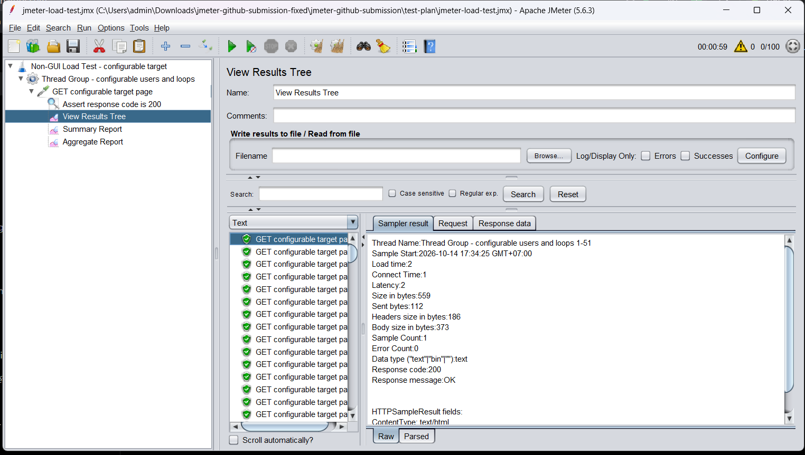
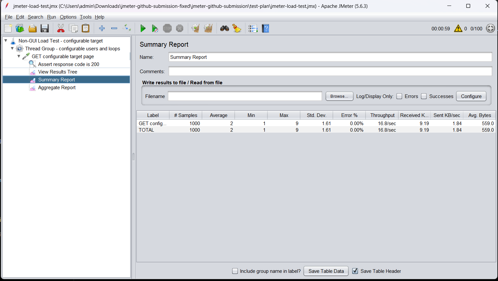
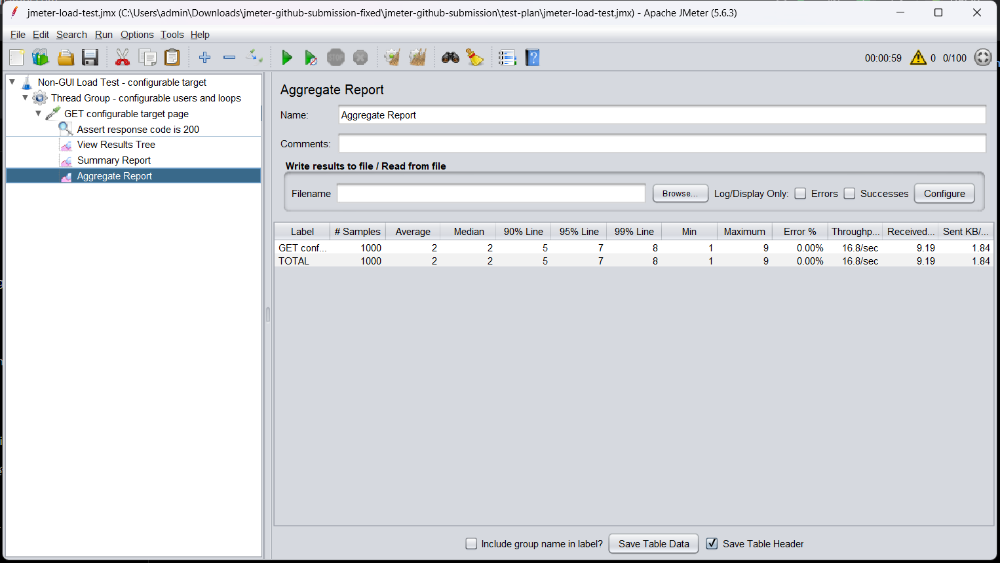

## Kịch bản kiểm thử (Test Plan Configuration)
- **Target:** `GET configurable target page`
- **Cấu hình Thread Group:** 
  - Số lượng người dùng (Threads): [Điền số lượng của bạn, ví dụ: 50]
  - Thời gian khởi động (Ramp-up): [Ví dụ: 1 giây]
  - Số vòng lặp (Loop count): [Ví dụ: 20] (Tổng số request = 1000)
- **Assertion:** Kiểm tra mã phản hồi `Response code is 200`.

## Kết quả thực hiện

### Kết quả chi tiết (View Results Tree)
Hình ảnh dưới đây minh họa các request đã được gửi thành công với mã phản hồi HTTP 200 (OK).

*Nhận xét:* Tất cả các request đều trả về HTTP 200. Thời gian tải (Load time) rất thấp, trung bình chỉ từ 1-2ms. Không có lỗi xảy ra.

### Báo cáo tổng hợp (Summary Report)

**Phân tích số liệu:**
- **Số lượng mẫu (Samples):** 1000
- **Thời gian phản hồi trung bình (Average):** 2 ms
- **Thời gian phản hồi nhanh nhất (Min):** 1 ms
- **Thời gian phản hồi chậm nhất (Max):** 9 ms
- **Độ lệch chuẩn (Std. Dev.):** 1.61
- **Tỷ lệ lỗi (Error %):** 0.00% (Hoàn hảo)
- **Thông lượng (Throughput):** 16.8 requests/giây
- **Dữ liệu nhận về (Received):** 9.19 KB/sec

### Báo cáo chi tiết (Aggregate Report)

**Phân tích số liệu (Phân vị):**
- **Trung vị (Median):** 2 ms
- **Phân vị 90% (90% Line):** 5 ms (90% request có thời gian phản hồi dưới hoặc bằng 5ms)
- **Phân vị 95% (95% Line):** 7 ms
- **Phân vị 99% (99% Line):** 8 ms

## Đánh giá và Kết luận
- Hệ thống đáp ứng rất tốt với tải trọng 1000 request.
- Tỷ lệ lỗi là 0%, chứng tỏ hệ thống hoạt động ổn định dưới mức tải này.
- Thời gian phản hồi trung bình cực thấp (2ms) và độ lệch chuẩn nhỏ (1.61), cho thấy hiệu năng rất ổn định, không có hiện tượng nghẽn cổ chai (bottleneck) ở mức tải hiện tại.

## Hướng dẫn chạy lại bài test
1. Cài đặt Apache JMeter (khuyến nghị bản 5.6.3 trở lên).
2. Mở file `test-plan/jmeter-load-test.jmx` bằng JMeter.
3. Nhấn nút "Start" (biểu tượng play màu xanh) để chạy test.
4. Xem kết quả tại các Listener: View Results Tree, Summary Report, Aggregate Report.